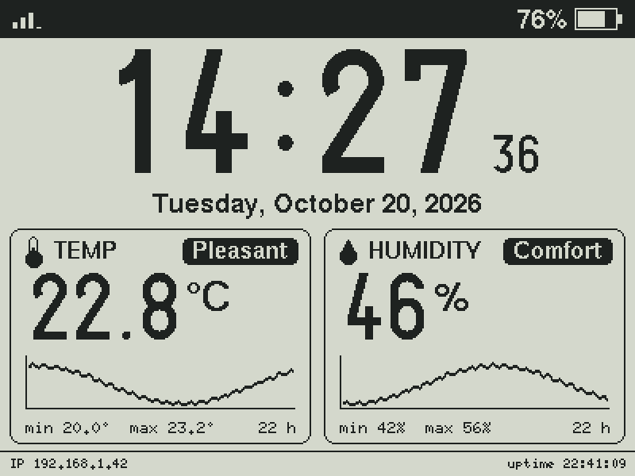
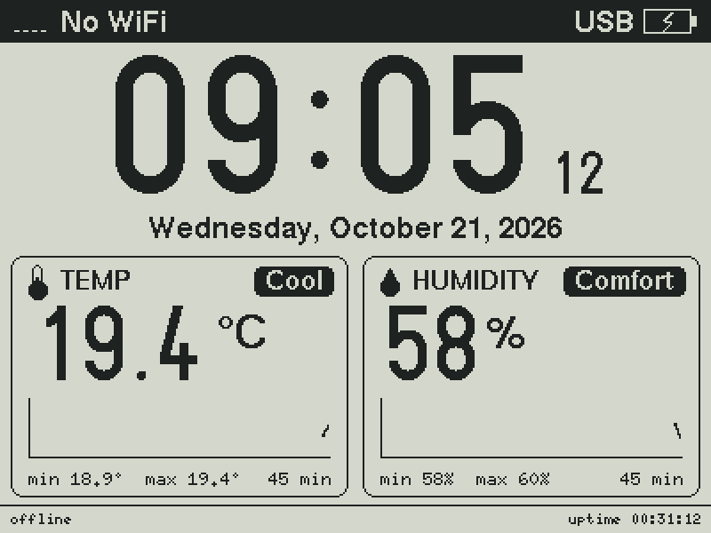

# ESP32 RLCD Dashboard

Desk clock and indoor climate dashboard for the
[Waveshare ESP32-S3-RLCD-4.2](https://github.com/waveshareteam/ESP32-S3-RLCD-4.2)
(4.2" 400x300 reflective LCD).

- Large clock from the on-board PCF85063 RTC, kept accurate via NTP
- Full date line
- Temperature and humidity (SHTC3) with comfort labels, min/max and a ~22 h chart
- Header with WiFi signal strength and battery level; footer with IP and uptime



<details>
<summary>Offline, right after boot</summary>



</details>

## Project layout

```
esp32-rlcd-dashboard/
├── esp32-rlcd-dashboard.ino   # Entry point: setup(), loop(), app state
├── config.h                   # Pins, timings, thresholds, time zone
├── secrets.example.h          # Template for secrets.h (WiFi credentials)
└── src/
    ├── st7305_u8g2.*          # ST7305 display driver exposed as a U8G2 object
    ├── shtc3.*                # SHTC3 temperature/humidity sensor driver
    ├── pcf85063.*             # PCF85063 RTC driver
    ├── battery.*              # Battery voltage and charge estimate
    ├── network.*              # WiFi connection and NTP time
    ├── date_time.h            # DateTime struct and helpers
    ├── history.h              # Sample history for the charts
    └── ui.*                   # Dashboard rendering (no hardware access)
```

`docs/images/` holds the screenshots, generated by `tools/screenshots/`.

## Getting started

1. Copy `secrets.example.h` to `secrets.h` and set your 2.4 GHz WiFi credentials.
   `secrets.h` is git-ignored.
2. Review `config.h` (time zone, temperature offset, intervals...).
3. Install the **U8g2** library (Library Manager).
4. Open `esp32-rlcd-dashboard.ino` in Arduino IDE and select:
   - Board: **ESP32S3 Dev Module** (esp32 by Espressif >= 3.3.0)
   - Flash Size: **16MB**
   - PSRAM: **OPI PSRAM**
   - USB CDC On Boot: **Enabled**
5. Upload.

Or with `arduino-cli`:

```sh
arduino-cli compile --upload -p <PORT> \
  --fqbn "esp32:esp32:esp32s3:PSRAM=opi,FlashSize=16M,CDCOnBoot=cdc" .
```

## Hardware

| Peripheral          | Interface | Pins / address                     |
| ------------------- | --------- | ---------------------------------- |
| ST7305 display      | SPI       | SCK 11, MOSI 12, DC 5, CS 40, RST 41 |
| SHTC3 temp/humidity | I2C       | SDA 13, SCL 14, `0x70`             |
| PCF85063 RTC        | I2C       | `0x51`                             |
| Battery sense       | ADC       | GPIO 4 (1/3 divider)               |

## Notes

- The SHTC3 sits close to the ESP32 and reads high; `TEMP_OFFSET_C` in
  `config.h` compensates for it. Calibrate it against a trusted thermometer.
- If the RTC lost power and NTP is unreachable, the clock starts from the
  firmware build time and the date line shows a warning.

## Screenshots

The images above are rendered from the real `src/ui.cpp` on a PC, so they match
the device pixel for pixel. To regenerate them after a UI change (Linux, macOS
or WSL, with `gcc`/`g++`):

```sh
tools/screenshots/build.sh
```

Scenes are defined in `tools/screenshots/main.cpp`.

## License

[MIT](LICENSE)
