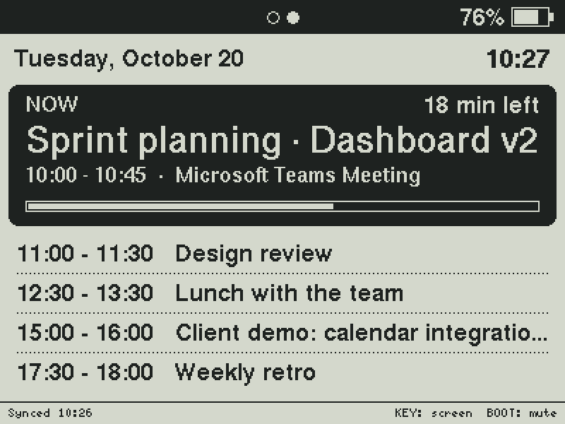
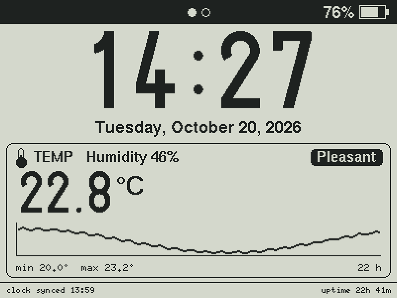
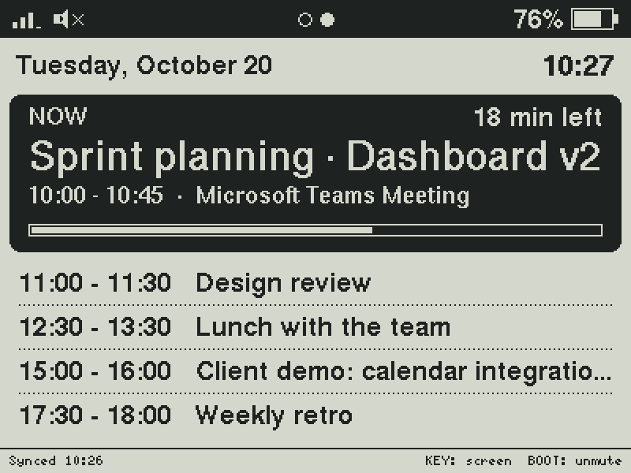
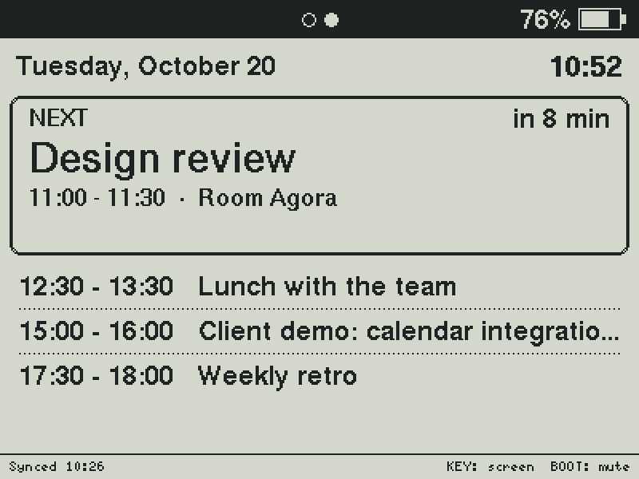
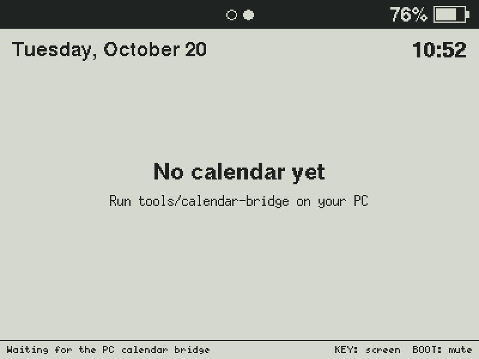

# ESP32 RLCD Dashboard

Desk clock and indoor climate dashboard for the
[Waveshare ESP32-S3-RLCD-4.2](https://github.com/waveshareteam/ESP32-S3-RLCD-4.2)
(4.2" 400x300 reflective LCD).

- Large clock from the on-board PCF85063 RTC, re-synced via NTP every hour
- Low power by design: one screen refresh per minute, CPU light sleep, no
  Bluetooth, WiFi on only in short windows (see [Power](#power))
- Full date line
- Temperature and humidity (SHTC3) with comfort labels, min/max and a chart that always fills its width (1 min per point at first, then 5 min, up to 15 min per point for ~22 h)
- Header with WiFi signal strength (only while connected), page dots and
  battery level; footer with IP (or last clock sync) and uptime
- Daily Teams/Outlook calendar: the meeting in progress and the next ones, with a
  beep 5 minutes before each meeting and another when it starts. A small PC
  program feeds it from Outlook (see [Teams calendar](#teams-calendar))




<details>
<summary>Right after boot, clock not synced yet</summary>


</details>

<details>
<summary>BOOT: single chart on the dashboard, muted beeps on the calendar</summary>





</details>

<details>
<summary>Calendar between meetings, and before the first push</summary>





</details>

## Project layout

```
esp32-rlcd-dashboard/
├── esp32-rlcd-dashboard.ino   # Entry point: setup(), loop(), app state
├── config.h                   # Pins, timings, thresholds, time zone
├── secrets.example.h          # Template for secrets.h (WiFi credentials, calendar token)
├── src/
│   ├── st7305_u8g2.*          # ST7305 display driver exposed as a U8G2 object
│   ├── shtc3.*                # SHTC3 temperature/humidity sensor driver
│   ├── pcf85063.*             # PCF85063 RTC driver
│   ├── speaker.*              # ES8311 codec + amplifier: beeps
│   ├── battery.*              # Battery voltage and charge estimate
│   ├── network.*              # WiFi connection and NTP time
│   ├── calendar.*             # Today's meetings and their alerts (no hardware access)
│   ├── calendar_server.*      # HTTP endpoint the PC bridge pushes to, mDNS
│   ├── date_time.h            # DateTime struct and helpers
│   ├── history.h              # Sample history for the charts
│   └── ui.*                   # Screen rendering (no hardware access)
└── tools/
    ├── calendar-bridge/       # PC program: Outlook calendar -> board
    └── screenshots/           # Renders the README images on a PC
```

`docs/images/` holds the screenshots, generated by `tools/screenshots/`.

## Getting started

1. Copy `secrets.example.h` to `secrets.h` and set your 2.4 GHz WiFi credentials
   and, for the calendar, a `CALENDAR_TOKEN` (any long random string).
   `secrets.h` is git-ignored.
2. Review `config.h` (time zone, temperature offset, intervals, calendar...).
3. Install the **U8g2** library (Library Manager).
4. Open `esp32-rlcd-dashboard.ino` in Arduino IDE and select:
   - Board: **ESP32S3 Dev Module** (esp32 by Espressif >= 3.3.0)
   - Flash Size: **16MB**
   - PSRAM: **OPI PSRAM**
   - USB CDC On Boot: **Enabled**
5. Upload.

Or with `arduino-cli`:

```sh
arduino-cli compile --upload -p <PORT> \
  --fqbn "esp32:esp32:esp32s3:PSRAM=opi,FlashSize=16M,CDCOnBoot=cdc" .
```

## Teams calendar

The board can't sign in to a work Microsoft 365 account by itself: that would
need an Azure app and, usually, admin consent. Instead, a small program on your
PC reads the calendar from Outlook (the new Outlook's offline cache, or the
classic app) and pushes today's meetings to the board over WiFi. See
[`tools/calendar-bridge/`](tools/calendar-bridge/README.md) for the setup.

- The calendar screen shows the meeting in progress (with time left and a
  progress bar) or the next one, followed by the rest of the day, up to 5 in total.
- **Two short beeps** 5 minutes before a meeting (`CALENDAR_ALERT_EARLY_MIN`),
  and the screen switches to the calendar. **Three long beeps** when it starts.
- **KEY** button (next to BOOT): switches between dashboard and calendar, or
  silences a beep in progress. Dots in the header show the current page.
- **BOOT** button, a different action on each screen:
  - Calendar: mutes or unmutes the meeting beeps. While muted, a crossed-out
    speaker shows in the header and a meeting still switches the screen to the
    calendar, just without sound. Beeps come back by themselves the next day.
  - Dashboard: cycles the charts: both, temperature only, humidity only (the
    chosen one gets the full width and the other reading moves to its title).
- When the last meeting of the day ends, the board goes back to the dashboard
  once (pressing KEY afterwards still shows the empty calendar).
- Each push replaces all events with the latest version: deleted meetings
  disappear, and a meeting moved to another time beeps again at its new time.
  The PC program sends at most one meeting per name (the most recently modified).
- Events are kept in RAM, so alerts still play if the PC goes away. The footer
  warns after `CALENDAR_STALE_MIN` minutes without news from the PC.
- The board only listens during its [WiFi windows](#power), so the PC pushes
  inside them (the scheduled task is aligned with them).
- Set `CALENDAR_TOKEN` in `secrets.h`. The PC must send the same token.
- Turned on with `CALENDAR_ENABLED` in `config.h`.

## Power

There is a single, efficient mode (no switch to turn it on):

- **Screen**: redrawn once per minute, right after the minute changes (no
  seconds on the clock), and immediately when KEY is pressed.
- **CPU**: runs at 80 MHz (`CPU_FREQ_MHZ`) and light-sleeps between refreshes;
  the reflective LCD keeps the image without power. KEY wakes it up.
- **Bluetooth**: never started.
- **WiFi**: off, except in a window that opens at minute :59, :14, :29 and :44
  and closes at :01, :16, :31 and :46 (`WIFI_WINDOW_*` in `config.h`). In a
  window the board connects, listens for the PC's calendar push and, if the
  last sync is about an hour old, re-syncs the clock via NTP (the :59 window).
  It switches WiFi off as soon as the calendar arrives. If a clock sync fails,
  WiFi is switched on again just for it every `NTP_RETRY_MIN` (5) minutes,
  also outside the windows, until it works. The WiFi icon only shows while
  actually connected.
- **Audio**: the speaker codec and I2S are only powered while a beep plays.
- The temperature sensor, battery and chart are sampled once a minute. With the
  board no longer running hot all the time, `TEMP_OFFSET_C` was lowered to
  -1.5 as an estimate: **calibrate it** against a trusted thermometer.

USB serial output is interrupted while the board sleeps, and so is the USB
upload port (see Troubleshooting).

## Troubleshooting

### Upload fails with "Could not open COMx, the port is busy or doesn't exist"

```
A fatal error occurred: Could not open COM11, the port is busy or doesn't exist.
(Cannot configure port, something went wrong. Original message: PermissionError(13, 'A device attached to the system is not functioning.', None, 31))
```

The ESP32-S3 uses its native USB, which stops responding while the chip
light-sleeps (which is most of the time). Windows still lists the port, but it
can't be opened.

To upload anyway, put the board into download mode by hand:

1. Hold **BOOT**.
2. Press and release **RESET** (or re-plug the USB cable).
3. Release **BOOT** and upload again. The port number may change, so check it
   with `arduino-cli board list`.
4. Press **RESET** after uploading to start the sketch.

Also make sure no serial monitor (e.g. Arduino IDE) has the port open.

## Hardware

| Peripheral          | Interface | Pins / address                     |
| ------------------- | --------- | ---------------------------------- |
| ST7305 display      | SPI       | SCK 11, MOSI 12, DC 5, CS 40, RST 41 |
| SHTC3 temp/humidity | I2C       | SDA 13, SCL 14, `0x70`             |
| PCF85063 RTC        | I2C       | `0x51`                             |
| ES8311 audio codec  | I2C + I2S | `0x18`; MCLK 16, BCLK 9, WS 45, DOUT 8 |
| Speaker amplifier   | GPIO      | 46 (enable, active high)           |
| KEY button          | GPIO      | 18 (active low)                    |
| BOOT button         | GPIO      | 0 (active low; held at reset: download mode) |
| Battery sense       | ADC       | GPIO 4 (1/3 divider)               |

## Notes

- The SHTC3 sits close to the ESP32 and reads high; `TEMP_OFFSET_C` in
  `config.h` compensates for it. Calibrate it against a trusted thermometer.
- The RTC is re-synced via NTP every `NTP_RESYNC_MIN` (60) minutes, in a WiFi
  window. After a failed attempt it retries every `NTP_RETRY_MIN` (5) minutes.
- If the RTC lost power and NTP is unreachable, the clock starts from the
  firmware build time and the date line shows a warning.

## Screenshots

The images above are rendered from the real `src/ui.cpp` on a PC, so they match
the device pixel for pixel. To regenerate them after a UI change (Linux, macOS
or WSL, with `gcc`/`g++`):

```sh
tools/screenshots/build.sh
```

Scenes are defined in `tools/screenshots/main.cpp`.

## License

[MIT](LICENSE)
